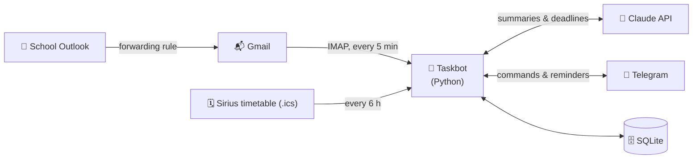

# 🤖 Taskbot

**A personal Telegram assistant for people who forget everything.**

Taskbot keeps track of my tasks, reads my university email, knows my class timetable and reminds me about everything before it's too late. It runs 24/7 on a small cloud server and only answers to its owner.

> Built from scratch as a first-year student project at FIT ČVUT. 🎓

---

## ✨ Features

| | Feature | What it does |
|---|---|---|
| 📝 | **Tasks** | Add tasks in plain language: `/add tomorrow 14:30 Doctor` |
| 🔁 | **Repeating tasks** | Weekly chores, monthly bills, daily habits: `/every tue Take out trash` |
| ⏰ | **Smart reminders** | 1 day and 1 hour before timed tasks, 2 days before deadlines |
| 🔘 | **One-tap actions** | Buttons under every reminder: ✅ Done · ⏰ In 1 hour · 📅 Tomorrow |
| ☀️ | **Morning brief** | Every day at 8:00: today's classes, overdue tasks, today and tomorrow |
| 📊 | **Weekly summary** | Every Sunday: what I finished and what's coming next week |
| 📧 | **AI email summaries** | New school emails are summarized by Claude and deadlines become one-tap tasks |
| 🎓 | **Class timetable** | Imports the iCalendar export from Sirius, reminds 15 min before each class |
| 🔒 | **Private** | Only the owner can use the bot |

## 🧭 How it works



1. School email is forwarded to a separate Gmail inbox that only the bot reads.
2. Every few minutes the bot fetches new messages and asks Claude for a short summary and any deadlines (as JSON).
3. The summary arrives in Telegram with **➕ Add to tasks** buttons. Nothing is added without a tap.
4. A scheduler checks tasks every minute and sends reminders, the morning brief and the weekly summary.

## 💬 Commands

| Command | Example | Description |
|---|---|---|
| `/add <when> [HH:MM] <task>` | `/add fri 10:00 Linear algebra exam` | Add a task |
| `/every <rule> [HH:MM] <task>` | `/every 1 10:00 Pay phone bill` | Repeating task (`day`, `mon`–`sun`, or day of month) |
| `/list` | | All open tasks |
| `/today` | | Overdue, today and tomorrow |
| `/done <id>` | `/done 7` | Mark as done (repeating tasks move to the next date) |
| `/edit <id> <when> [HH:MM]` | `/edit 7 sat 18:00` | Reschedule a task |
| `/rename <id> <title>` | `/rename 7 Dentist` | Rename a task |
| `/delete <id>` | `/delete 7` | Delete a task |
| `/schedule [when]` | `/schedule tomorrow` | Classes for a day (also `/rozvrh`) |
| `/checkmail` | | Check email right now |

**Dates:** `today`, `tomorrow`, `mon`–`sun`, `20.11.`, `20.11.2026`, `2026-11-20` (Russian words like `завтра` and `пт` work too).

## 🛠️ Tech stack

- **Python 3** with [`python-telegram-bot`](https://python-telegram-bot.org/) (async, job queue for scheduling)
- **SQLite** for tasks, settings and history (with automatic schema migrations)
- **Claude API** (`anthropic` SDK) for email summaries and deadline extraction
- **IMAP** (`imaplib`) for reading email, **iCalendar** (`icalendar`, `recurring-ical-events`) for the timetable
- **Ubuntu** on an **Azure** VM, run as a **systemd** service with auto-restart
- **Git + GitHub** with a read-only deploy key on the server

## 🚀 Setup

### 1. Run locally

```bash
git clone git@github.com:<your-username>/taskbot.git
cd taskbot
pip3 install -r requirements.txt
cp start.example.sh start.sh   # then fill in your keys
bash start.sh
```

Open your bot in Telegram and send `/start`. The first person to do this becomes the owner.

### 2. Configuration

All settings come from environment variables. Only `BOT_TOKEN` is required; the other features switch on when their variables are set.

| Variable | Needed for | Where to get it |
|---|---|---|
| `BOT_TOKEN` | everything | [@BotFather](https://t.me/BotFather) on Telegram |
| `GMAIL_ADDRESS` | email | the Gmail inbox your school mail is forwarded to |
| `GMAIL_APP_PASSWORD` | email | Google Account → App passwords (needs 2-step verification) |
| `ANTHROPIC_API_KEY` | email | [console.anthropic.com](https://console.anthropic.com) |
| `CLAUDE_MODEL` | optional | defaults to `claude-haiku-5-5` |
| `TIMETABLE_URL` | timetable | Sirius → iCalendar export |
| `CLASS_REMIND_MINUTES` | optional | minutes before a class to remind (`0` = off) |

### 3. Run 24/7 on a server

The bot only needs outbound internet access, so any small Linux VM works (1 vCPU / 1 GB RAM is plenty).

```bash
# on the server
git clone git@github.com:<your-username>/taskbot.git ~/bot
cd ~/bot
python3 -m venv venv
venv/bin/pip install -r requirements.txt
# put your variables into ~/bot/bot.env (KEY="value" per line, no "export")
```

`/etc/systemd/system/taskbot.service`:

```ini
[Unit]
Description=Telegram task bot
After=network-online.target
Wants=network-online.target

[Service]
User=azureuser
WorkingDirectory=/home/azureuser/bot
EnvironmentFile=/home/azureuser/bot/bot.env
ExecStart=/home/azureuser/bot/venv/bin/python bot.py
Restart=always
RestartSec=10

[Install]
WantedBy=multi-user.target
```

```bash
sudo systemctl enable --now taskbot
```

**Deploying updates:** `git push` on your machine, then on the server:

```bash
cd ~/bot && git pull && venv/bin/pip install -q -r requirements.txt && sudo systemctl restart taskbot
```

## 🔐 Security

- **No secrets in Git.** Keys live in `start.sh` / `bot.env`, which are in `.gitignore`. The repo only contains `start.example.sh` with placeholders.
- **Owner-only.** The bot answers only to the Telegram account that started it.
- **SQL injection safe.** All database queries are parameterized.
- **AI has no power.** Claude only returns text; tasks from emails are added only after a button press. Summaries are hints, not facts: emails are untrusted input and may contain prompt injection.
- **Least privilege.** The server pulls code with a read-only deploy key; the bot reads a separate Gmail inbox, not the main one.
- **Cost limits.** At most 10 emails per check and each email is truncated, so a spam flood can't burn through API credit.

## 📁 Project structure

```
taskbot/
├── bot.py             # the whole bot: commands, scheduler, email, timetable
├── requirements.txt   # Python dependencies
├── start.example.sh   # template for local start script (copy to start.sh)
├── .gitignore         # keeps secrets and personal data out of Git
└── README.md
```

Not in Git (created locally): `start.sh`, `bot.env`, `tasks.db`, `timetable.ics`.

## 🗺️ Roadmap

- [x] Tasks, reminders and morning brief
- [x] AI email summaries with one-tap deadlines
- [x] Deployment on a cloud server with systemd
- [x] Git workflow with deploy key
- [x] Sirius timetable import and class reminders
- [x] Repeating tasks, reminder buttons, editing, weekly summary
- [ ] Automatic deployment with GitHub Actions
- [ ] Nightly database backups
- [ ] Add tasks in plain text with AI (no `/add` needed)
- [ ] Owner locked by Telegram ID in config

## 👤 Author

Made by [@ntmrkx](https://github.com/ntmrkx), first-year Informatics student at [FIT ČVUT](https://fit.cvut.cz) in Prague.
